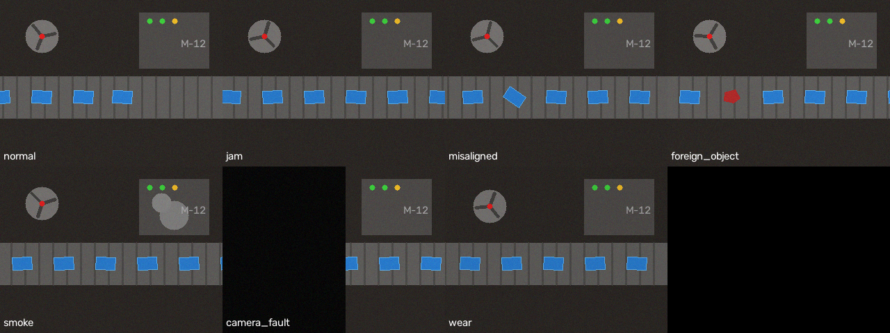
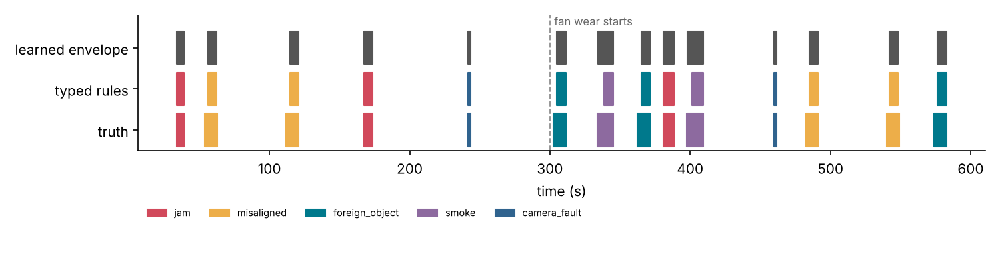
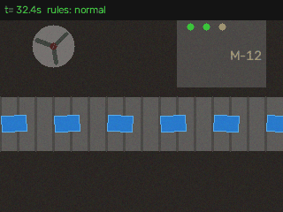
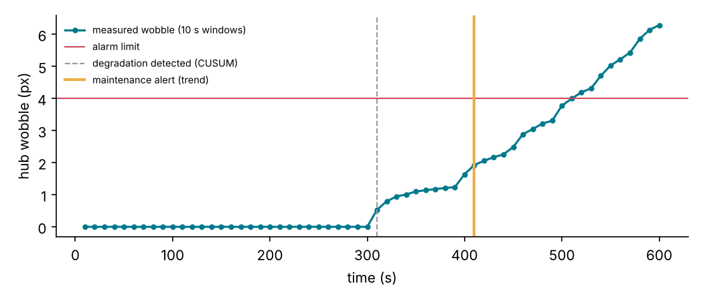
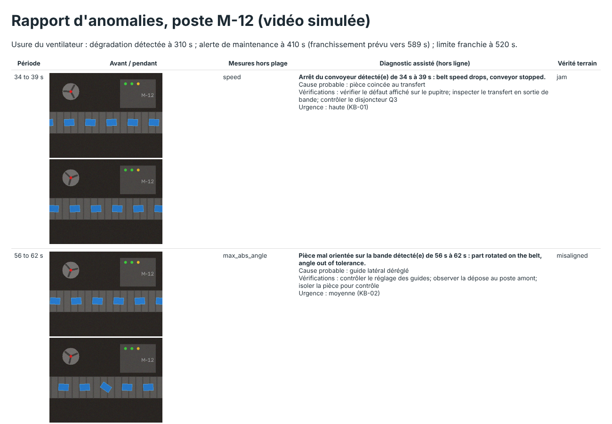

# Détection d'anomalies sur flux vidéo de production et diagnostic assisté

[](https://github.com/Abderrahmane-BOULAMI/video-anomaly-inspector/actions/workflows/tests.yml)

Une caméra fixe au-dessus d'un poste voit beaucoup de choses que les automates ne remontent pas : une bande qui
s'arrête, une pièce de travers, un objet qui n'a rien à faire là, de la fumée devant une machine, un ventilateur qui
commence à se décentrer. Ce projet transforme ce flux vidéo en événements exploitables par la maintenance :

1. **Des mesures par image** avec OpenCV : vitesse de la bande (corrélation de phase), objets sur la bande (nombre,
   angle, forme, couleur), aspect de la zone machine, qualité de l'image, position du moyeu du ventilateur.
2. **Quatre détecteurs**, tous calibrés sur une vidéo **normale uniquement**, comparés sur deux vidéos de test.
3. **De la maintenance prédictive** : l'amplitude du balourd du ventilateur, mesurée sur l'image, détecte le début
   de l'usure et annonce le dépassement de la limite avant qu'il n'arrive.
4. **Un diagnostic assisté par IA générative** : chaque événement devient un dossier de preuves (mesures, deux images
   clés), une recherche dans une base de connaissances maintenance retrouve la fiche la plus proche, et un modèle
   multimodal (Gemini sur Vertex AI) rédige le message pour l'opérateur au format JSON. Une version hors ligne
   remplit la même structure sans modèle, pour que tout tourne et soit testé sans cloud.

La vidéo est **simulée** (`vidanom/synth.py`) pour connaître exactement le début et la fin de chaque anomalie et
pouvoir mesurer les détecteurs. Les zones d'intérêt (bande, machine, ventilateur) sont propres à cette scène et
seraient à redéfinir sur une vraie caméra.



## Résultats

Deux vidéos de test de 10 minutes chacune (6 000 images à 10 images/s), 14 anomalies par vidéo, et une vidéo
normale de 200 secondes pour calibrer.

### 1. Détection

| Détecteur | Principe | Anomalies trouvées (vidéo A / B) | Fausses alertes | Délai moyen |
|---|---|---|---|---|
| Règles typées | Un test par type d'anomalie, seuils physiques ou tirés de la vidéo normale | **14/14 et 14/14** | 0 | 1,7 à 1,9 s |
| Enveloppe apprise | Plage normale de chaque mesure, alerte si une mesure en sort | **14/14 et 14/14** | 0 | 1,2 à 1,3 s |
| Isolation Forest | Forêt d'isolement sur les mêmes mesures | 0/14 et 0/14 | 1 | |
| ACP sur les pixels | Erreur de reconstruction d'images réduites, sans aucune mesure | 10/14 et 9/14 | 3 | 0,2 s |



Ce qu'on en retient :

- **L'Isolation Forest ne voit rien**, et ce n'est pas un réglage : une mesure qui ne varie jamais dans la vidéo
  normale (l'angle des pièces, la couleur) n'est jamais utilisée pour couper l'arbre, donc une pièce de travers ne
  l'isole pas plus qu'une autre. Un test unitaire documente cette limite.
- **L'enveloppe apprise** trouve tout sans écrire de règle, et elle dit quelle mesure est sortie de sa plage : c'est
  ce qui alimente le diagnostic.
- **L'ACP sur les pixels** réagit vite mais rate les petites anomalies (une pièce de travers change peu de pixels)
  et se déclenche sur des variations normales.
- Les délais viennent surtout du temps qu'une pièce met à entrer entièrement dans le champ (2,4 s pour une pièce de
  travers) et du temps qu'il faut à la fumée pour devenir visible.



### 2. Maintenance prédictive : usure du ventilateur

| Étape | Instant |
|---|---|
| Début réel de l'usure | 300 s |
| Usure détectée (CUSUM sur l'amplitude mesurée par fenêtres de 10 s) | 310 s |
| Alerte de maintenance (tendance qui atteint la limite dans moins de 180 s) | 410 s |
| Limite de 4 px franchie | 520 s |

L'alerte arrive 110 s avant le franchissement, sur une dégradation simulée qui dure 5 minutes (des semaines dans la
réalité). La date annoncée au moment de l'alerte (589 s) est en retard de 69 s sur le franchissement réel : la
tendance linéaire sous-estime une usure qui s'accélère. Une tendance quadratique a été essayée ; elle réagissait au
bruit et annonçait le franchissement bien trop tôt.



### 3. Diagnostic assisté

Pour chaque événement de l'enveloppe apprise, les mesures sorties de leur plage sont traduites en texte et servent
de requête dans la base de connaissances (`knowledge/diagnostics.yaml`, 6 fiches : symptômes, causes,
vérifications, urgence).

| | Vidéo A | Vidéo B |
|---|---|---|
| Événements diagnostiqués | 14 | 14 |
| Bonne fiche retrouvée en premier | **14** | **14** |
| Réponses non conformes au schéma JSON | 0 | 0 |

La première version se trompait sur les caméras masquées (12/14) : le bruit d'une image noire crée de fausses
taches colorées, que la recherche prenait pour un corps étranger. Une règle de bon sens a corrigé cela (si l'image
est en grande partie noire, les autres mesures ne sont pas fiables). Elle a été ajoutée après avoir vu l'erreur
sur ces deux vidéos ; il faudrait la confirmer sur d'autres.

Le prompt envoyé au modèle multimodal contient les mesures, les fiches retrouvées et deux images (avant et
pendant) ; il impose de n'utiliser que ces éléments et un format JSON vérifié à la réception
(`results/prompt_examples.json`). **Le backend Vertex AI est écrit mais n'a pas été appelé** : pas d'accès cloud ici.
Le rapport HTML (`results/report.html`) est produit avec la version hors ligne.



## Limites

- Vidéo simulée : éclairage, reflets, vibrations de la caméra et variété des pièces réelles ne sont pas représentés.
- Zones d'intérêt fixes, propres à la scène simulée.
- Base de connaissances illustrative de 6 fiches ; une vraie base indexerait les guides de dépannage et
  l'historique des ordres de travail.
- Pas de réseau de neurones : les mesures OpenCV suffisent sur cette scène ; une vraie caméra demanderait sans
  doute un détecteur d'objets appris.

## Lancer le projet

```bash
pip install -r requirements.txt
pytest -q                       # 12 tests
python experiments/run_all.py   # toutes les mesures, figures et le rapport (environ 3 min)
# optionnel : diagnostic par Gemini sur Vertex AI
pip install -r requirements-cloud.txt
export GOOGLE_CLOUD_PROJECT=...  # puis utiliser assist.VertexGeminiBackend()
```

## Organisation

```
vidanom/synth.py      scène simulée et anomalies étiquetées
vidanom/features.py   mesures par image (OpenCV)
vidanom/detect.py     règles, enveloppe apprise, Isolation Forest, ACP, découpage en événements, scores
vidanom/wear.py       amplitude du balourd, CUSUM, tendance et alerte de maintenance
vidanom/assist.py     preuves, base de connaissances, prompt, backends hors ligne et Vertex AI, contrôle du JSON
knowledge/            fiches de diagnostic
results/              chiffres, figures, rapport HTML, exemples de prompts
```

Licence MIT.
